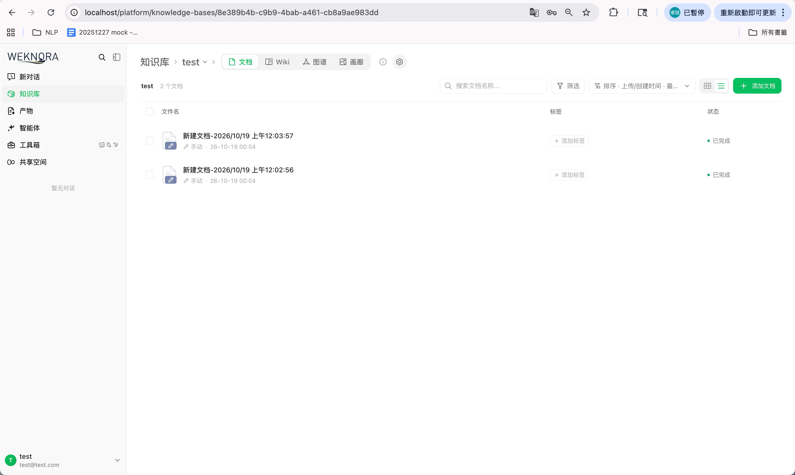
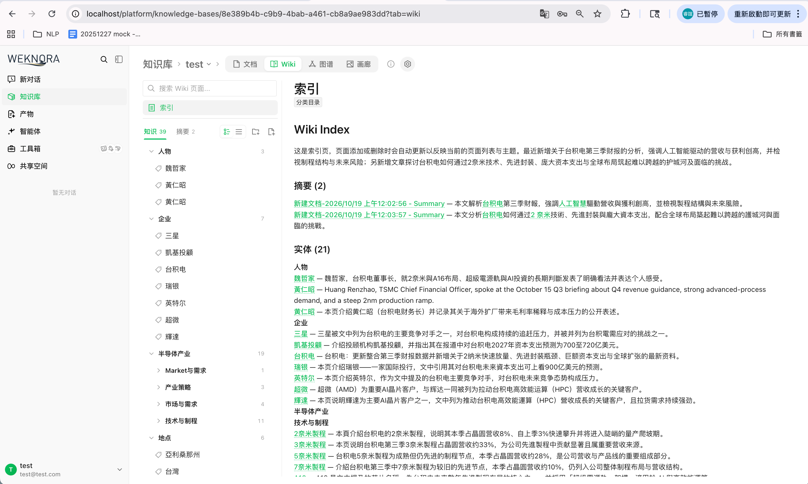

# WeKnora（Docker 版）與 llm-wiki 的差異觀察

> 狀態：工作筆記 · 日期：2026-10-19 · 作者：rywang
> 比較對象：用 `docker compose` 啟動的 WeKnora v0.8.2（標準版，ParadeDB）· Python 版：`llm-wiki/wikibuilder/`

---

## 1. 資料夾結構：WeKnora 有分類資料夾，llm-wiki 只有 `entity/` 和 `concept/`

### 觀察

Docker 服務建出來的 wiki，在 UI 上會看到 `半导体产业/技术与制程`、`企业`、`人物`、`地点` 這類資料夾。llm-wiki 產生的 wiki 在磁碟上只有 `entity/`、`concept/`、`summary/` 和 `index.md`。

### 結論：資料模型一樣，差在呈現方式

WeKnora 有兩層互相獨立的結構：

| 層 | 存在哪裡 | 例子 |
|---|---|---|
| 頁面 slug（類型前綴） | `wiki_pages.slug`、`wiki_pages.page_type` | `entity/taijidian`、`concept/cowos` |
| 分類資料夾（LLM 分類） | `wiki_folders` 表，由 `wiki_pages.folder_id` 指過去 | `企业`、`半导体产业/技术与制程` |

Docker 資料庫裡的 slug，用的前綴其實跟 llm-wiki 一樣：

| page_type | slug 前綴 | 數量 |
|---|---|---|
| entity | `entity/` | 21 |
| concept | `concept/` | 18 |
| summary | `summary/` | 2 |
| index | `index` | 1 |

UI 上的資料夾來自 `wiki_folders`，是 ingest 時分類步驟決定的（`WeKnora/internal/application/service/wiki_ingest_taxonomy.go`）。UI 照 `folder_id` 長出資料夾樹，跟 slug 無關。對應範例：

```
entity/taijidian       → 企业
entity/huang-ren-zhao  → 人物
entity/taiwan          → 地点
concept/cowos          → 半导体产业/技术与制程
concept/capital-expenditure → 财务与投资
```

llm-wiki 也跑了同樣的分類步驟，結果也有存下來，只是沒有拿來決定檔案位置：

- 分類 prompt：`wikibuilder/prompts.py:19-24`，在 `wikibuilder/reduce.py` 裡呼叫（`TAXONOMY_MAX_FOLDERS = 150`）。
- 結果存在 `WikiPage.category`（`wikibuilder/models.py:94`）。
- 檔案路徑直接用 slug（`wikibuilder/wiki_format.py:52-55`）：
  ```python
  def page_path(page, ctx):
      return f"{page.slug}.md"   # → entity/xxx.md
  ```
- 分類只寫進 frontmatter 的 `category:`，另外在 `index.md` 裡用來分組（`wiki_format.py:149`）。

### 改法：讓 llm-wiki 照分類放檔案

```python
def page_path(page, ctx):
    if page.page_type in (PAGE_ENTITY, PAGE_CONCEPT) and page.category:
        return "/".join(page.category + [page.slug.split("/", 1)[1]]) + ".md"
    return f"{page.slug}.md"
```

注意：頁面之間的連結是用 slug 寫的。用 `wikilink` 風格的話，像 Obsidian 這種靠檔名找頁面的工具還是解析得到；改用 `link_style: "markdown"` 的話，相對路徑連結會斷掉，連結的產生方式也要一起改。

### 附帶觀察：分類一致性

Docker 版同時建了 `半导体产业/Market与需求` 和 `半导体产业/市场与需求`，代表 LLM 沒有重用既有的分類名稱。這可以當作 `evaluation-design.md` 裡分類一致性評估的案例。另外也出現重複的 entity（`entity/huang-ren-zhao` 和 `entity/huang-renzhao`），dedup 沒有合併。

---

## 2. 跑 Docker 服務時遇到的問題

這些不是跟 llm-wiki 的差異，但會影響拿到的結果。

| 症狀 | 原因 | 修法 |
|---|---|---|
| `docker: unknown command: docker compose` | Docker Desktop 裝了但沒開過，compose plugin 還沒連結 | 開一次 Docker Desktop |
| 上傳後卡在 summary，log 出現 `Unknown parameter: 'chat_template_kwargs'` | OpenAI 模型是用「通用 OpenAI 相容」廠商加入的，會送出 vLLM/SGLang 用的思考開關參數 | 把模型的廠商改成 **OpenAI**（改走 Responses API 和 `reasoning.effort`） |
| 還是卡在 summary，log 出現 `summary model output was truncated at the completion budget` / `returned empty output` | `gpt-5-mini` 不能關閉推理，WeKnora 就不送 `reasoning` 參數，預設推理強度把 1024 token 的摘要上限用完了（`config/config.yaml` → `conversation.summary.max_completion_tokens`） | 把上限調高（例如 4096）再重啟 `app`，或摘要改用非推理模型 |
| `Vector/keyword indexing disabled for KB ..., skipping embedding model` | 建知識庫時沒開向量／關鍵字索引 | 在知識庫設定打開索引並選 embedding 模型 |

摘要失敗的時候，wiki 頁面還是建得出來，因為 wiki ingest 的呼叫上限是 32768 token。

---

## 3. 問答：分類到底存在哪裡

### Q1：每個 page 在 frontmatter 都有一個欄位在存它的分類嗎？

llm-wiki 有，WeKnora 沒有。

**llm-wiki** 的每個 page 在 frontmatter 都有 `category`，值是由大到小的資料夾名稱陣列，最多兩層：

```yaml
title: Cirrus Cloud
slug: entity/cirrus-cloud
type: entity
category:
- Software Products
```

目前 `wiki/` 的狀況（2026-10-19）：

| 類型 | 頁數 | `category` 有值 |
|---|---|---|
| entity | 7 | 7 |
| concept | 5 | 5 |
| summary | 2 | 0（`[]`） |

分佈：Technology Concepts 5、People 3、Software Products 2、Organizations 2。summary 沒有分類，因為分類步驟只處理 entity 和 concept（`wikibuilder/dedup.py:104`）。WeKnora 的 summary 和 index 同樣沒有 `folder_id`。

**WeKnora** 的頁面存在 Postgres，沒有 frontmatter：

- 資料夾本身是 `wiki_folders` 表的一列，有 `name`、`parent_id`、`path`（例如 `半导体产业/技术与制程`）。
- 頁面在 `wiki_pages.folder_id` 存一個資料夾 ID，指過去。

| | llm-wiki | WeKnora |
|---|---|---|
| 分類存在哪 | 頁面的 `category`（路徑字串陣列） | `wiki_pages.folder_id` → `wiki_folders` |
| 資料夾是不是獨立的東西 | 不是，從所有頁面的 `category` 收集出來（`wikibuilder/state.py:88`） | 是，有自己的 ID，可以改名、移動 |
| 拿來做什麼 | 只用在 `index.md` 分組 | UI 的資料夾樹 |

這也造成一個行為差異：在 WeKnora UI 改資料夾名稱，只要改一列，所有頁面都會跟著變。llm-wiki 沒有獨立的資料夾，想改名就得改每一頁的 `category`。

### Q2：所以 llm-wiki 有把分類寫在頁面上，WeKnora 存在資料庫、沒寫在頁面上？

對。不過 llm-wiki 頁面上的分類其實是**副本**，真正的資料也不在頁面裡：

| | 分類真正存在哪 | 頁面上看得到嗎 |
|---|---|---|
| **llm-wiki** | `.wiki_state/state.json` | 看得到，渲染時寫進每頁 frontmatter 的 `category` |
| **WeKnora** | Postgres：`wiki_pages.folder_id` → `wiki_folders` | 看不到，只在 UI 的資料夾樹顯示 |

`wikibuilder/state.py:4` 註明 `wiki/` 資料夾是從 state 推導出來的。所以兩邊其實都把分類存在一個集中的地方：llm-wiki 用 `state.json`，WeKnora 用資料庫。差別只在 llm-wiki 渲染時會把分類印到每個頁面上。

**直接改 `wiki/` 裡某頁 frontmatter 的 `category`，下次重新 build 時會被 `state.json` 的值蓋掉。**想讓修改留下來，要改 state，或改分類那一步的邏輯。

---

## 4. 我的使用結果

<!-- 在這裡補上兩邊實際使用下來的觀察。 -->

